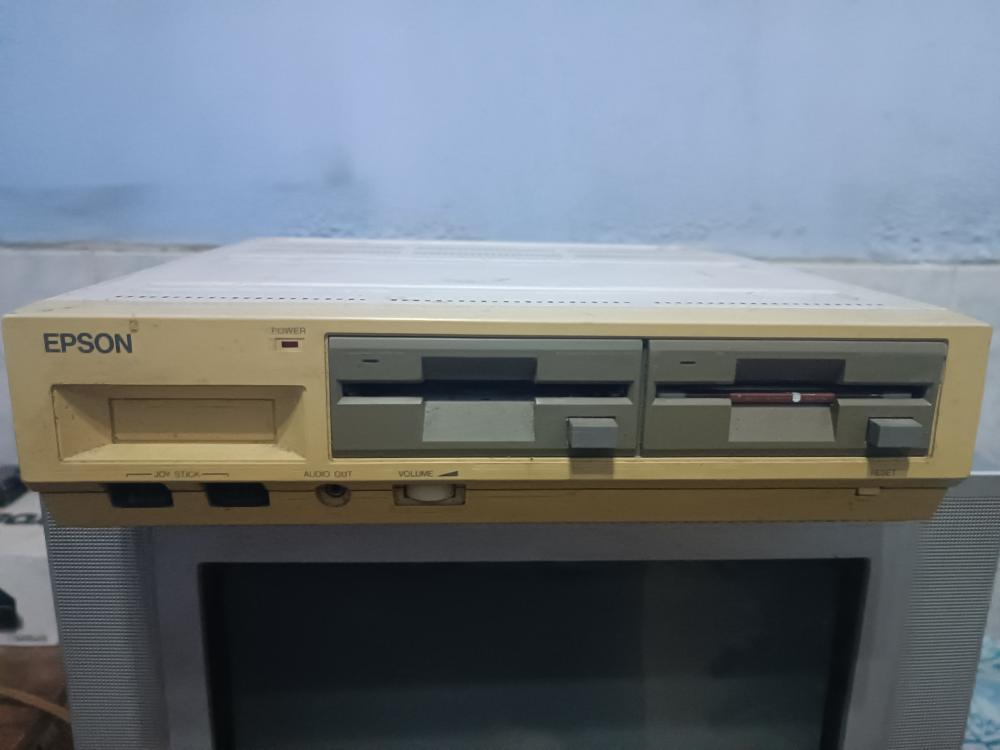

# Epson QX-11 Research Archive
**Hardware archaeology · Firmware analysis · Emulation**

Preserving the Epson QX-11, Japanese QC-11, and Venezuelan Abacus.

[Explore the research](Reverse%20Engineering/README.md) · [ROMs & boot flow](roms/README.md) · [Hardware photos](photos/motherboard/README.md) · [QX-16 companion archive](https://github.com/pradavic-1972/epson-qx16-research)

---

## Start with your project

| I want to… | Start here | Continue with |
| :--- | :--- | :--- |
| Understand the hardware | [Gate-array overview](Reverse%20Engineering/gate-arrays.md) | [IC inventory](ICs/Readme.md) · [Datasheets](Datasheets/index.md) |
| Investigate memory and ROMs | [GAVEMR memory logic](Reverse%20Engineering/GAVEMR.md) | [ROM expansion](Reverse%20Engineering/rom_expansion.md) · [Cartridge interface](Reverse%20Engineering/Cartridge.md) |
| Work on video | [GAVDP video hardware](Reverse%20Engineering/GAVDP.md) | [BIOS INT 10h](Reverse%20Engineering/INT10.md) · [RGB graphics](Reverse%20Engineering/QX11_RGB_Color_Graphics.md) |
| Boot software | [Floppy boot notes](Reverse%20Engineering/qx11_floppy_boot.md) | [Disk images](software/) · [ELKS experiment](Reverse%20Engineering/boot_elks_on_qx11.md) |
| Develop emulation | [MAME research](mame/README.md) | [Interrupt vectors](Reverse%20Engineering/QX11_IVT_Groups.md) · [HD-10 protocol](Reverse%20Engineering/Hard%20Drive%20access%20EPSON%20HD-10.md) |
| Compare Epson platforms | [QX-11 / QX-16 comparison](https://github.com/pradavic-1972/epson-qx16-research/blob/main/Reverse%20Engineering/QX11-QX16-Comparison.md) | [Cross-reference guide](CROSS_REFERENCES.md) |

## Explore the archive

**Hardware & firmware** — [Reverse engineering](Reverse%20Engineering/README.md), [ROM analysis and dumps](roms/README.md), [keyboard interface](Reverse%20Engineering/qx11_keyboard.md), and [motherboard photographs](photos/motherboard/README.md).

**Software & experiments** — [QX-11 Invaders](software/games/QX11%20Invaders/README.md), [QX-11 Chess](software/games/qx11-chess/README.MD), [MAME development](mame/README.md), and [Pico interface hardware](docs/QX11-Pico-Interface-Hardware.md).

**History & preservation** — [Magazine scans](magazine-scans/README.md), [Japanese QC-11 article](magazine-scans/ascii_aug1985/QC11_Article/README.md), and [Abacus advertisement](magazine-scans/mundoAtari_1988/qx11_ad_translation.md).

## Connected research

The [QX-16 archive](https://github.com/pradavic-1972/epson-qx16-research) provides a companion view of Epson hardware. Use the [topic-by-topic cross-reference guide](CROSS_REFERENCES.md) to move between video, interrupts, storage, and repair documentation.

These are different platforms. Shared components and related research do not establish interchangeable register maps, firmware, or hardware modifications. The individual articles retain their own findings, hypotheses, and limitations.

## Contribute

Corrections, measurements, ROM provenance, photographs, translations, and reproducible experiments are welcome through issues and pull requests. Include the machine variant, relevant article, and evidence so findings can be checked.

## License & preservation

Code, scripts, tools, and KiCad files use the [MIT License](LICENSE). Images, text documentation, diagrams, and ROM dumps are described under [CC BY 4.0](LICENSE-CC-BY.txt); please credit this repository.

Original software copyright remains with its respective owners. ROM dumps and photos are shared for educational and preservation purposes.
