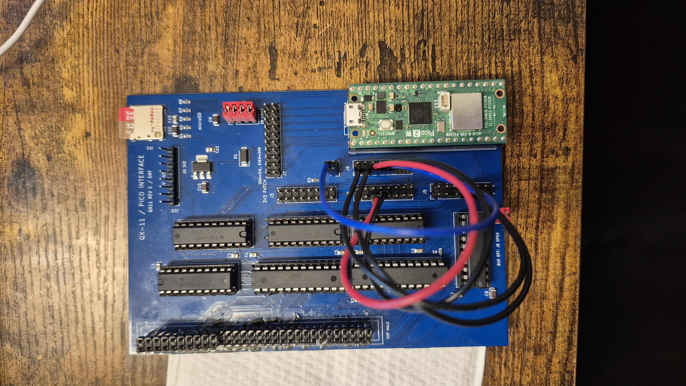
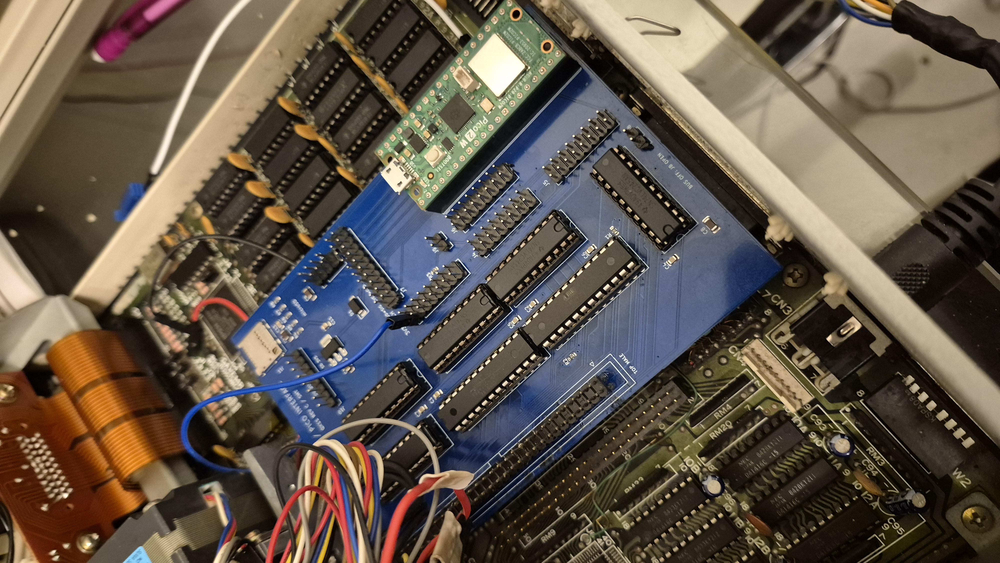
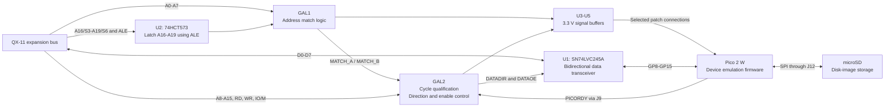
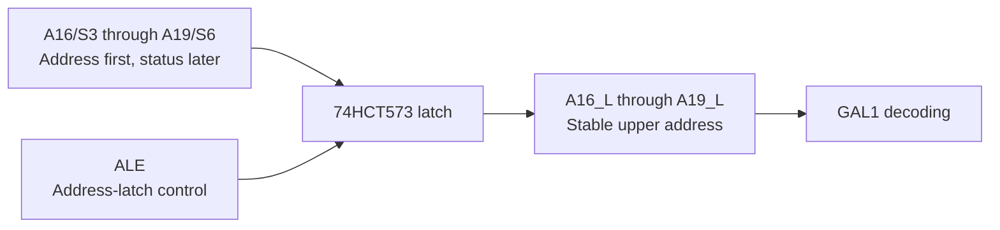
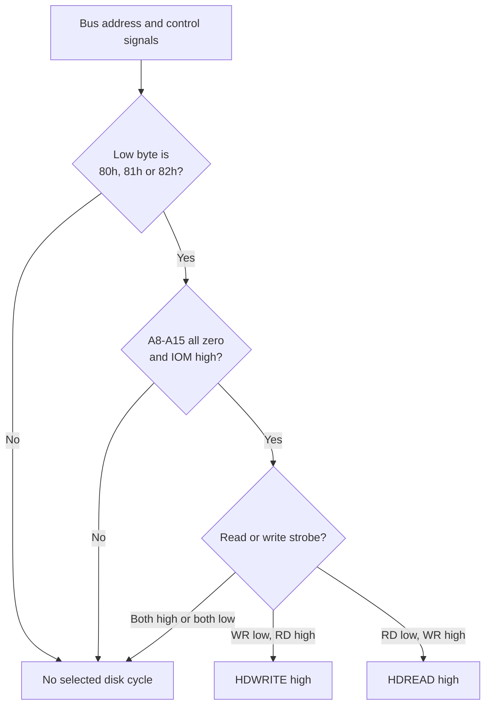
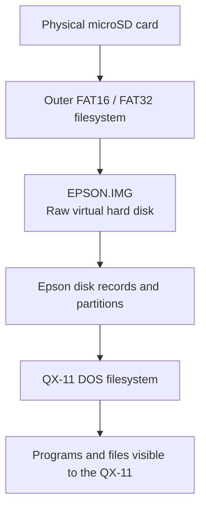

# QX-11 Universal Pico Interface Card

## Overview

The QX-11 Universal Pico Interface Card is a programmable expansion interface for the Epson QX-11. It combines two GAL22V10 programmable logic devices with a Raspberry Pi Pico 2 W, bus buffers, configurable patch headers and microSD storage.

Its first hardware-validated application is an **Epson HD-10-compatible hard-drive emulator**. The QX-11 communicates through its native disk-controller I/O ports, while Pico firmware translates disk requests into accesses to an image file on microSD. Physical testing has confirmed operating-system access with a **32 MB disk image**.

The interface separates two jobs:

- **GAL logic:** recognize bus addresses, qualify read/write cycles and control the data transceiver.
- **Pico firmware:** implement the selected device's registers, commands, data and backing storage.

“Universal” describes the configurable architecture. It does not imply that all peripherals, memory cycles, DMA or interrupts are already supported.

> **Documentation scope:** This document describes the saved GAL/Pico hard-drive implementation and the latest compact board pin map. Check the PCB revision and actual fitted devices before reproducing connections. Mermaid diagrams render directly on GitHub; they explain logical behavior and are not substitutes for the electrical schematic.

## Hardware photographs

These photographs show the assembled **Rev C / SMT** HD-Pico card and its installation inside the Epson QX-11. They document the physical board; the later compact PCB revision discussed below is a separate design revision.

### Assembled card



*The assembled card on the workbench, showing the Pico 2 W, GAL and buffer circuitry, configurable patch headers, and populated microSD interface. Photograph: October 29, 2026.*

### Installed in the QX-11



*The card installed inside the QX-11, showing its placement relative to the motherboard and surrounding components. Photograph: October 24, 2026.*

## Hardware blocks



| Component | Role |
|---|---|
| GAL1 / IC1 | Receives A0–A7 and latched A16–A19; generates programmable address-match outputs |
| GAL2 / IC2 | Receives A8–A15, RD, WR, IO/M and GAL1 matches; generates selected-cycle and transceiver controls |
| U1, SN74LVC245A | Transfers the eight data bits between the bus and Pico |
| U2, 74HCT573 | Captures the upper address bits while ALE is asserted |
| U3–U5, SN74LVC245A | Buffer selected bus/GAL signals into the 3.3 V domain |
| Pico 2 W | Runs the bus-service loop, controller protocol and storage firmware |
| U6, MCP1825ST-3302E/DB | Dedicated microSD 3.3 V regulator |
| J3–J9 | Signal patching and transceiver/interlock connections |
| J10 | Raw auxiliary bus signals; no level translation at this header |
| J11 / J12 | microSD socket and four SPI connection shunts |

The saved BOM specifies ATF22V10C-10PU devices for the GAL positions. Verify the actual fitted variant before programming or changing electrical assumptions.

## Why the upper address bits are latched

The expansion bus exposes A16/S3 through A19/S6. These pins carry upper address bits during the address phase, then carry processor status information later in the cycle.

U2 uses ALE to retain the address value after the pins change function:



The 74HCT573 is transparent while its latch-enable input is high and holds the captured value when it goes low. This makes stable upper-address information available for programmable region decoding.

The current hard-drive I/O decode does not use A16–A19 to select the disk ports. Their presence supports other address-decoding applications, including the project's separate ROM-selection work.

## Two-stage address decoding

### GAL1: select the low address byte

For the working hard-drive configuration, GAL1's active-high `MATCHA` recognizes low address bytes `80h`, `81h` and `82h`.

The project uses GALette-style Boolean notation:

| Notation | Meaning |
|---|---|
| `*` | AND |
| `+` | OR |
| `/` | NOT |

```text
MATCHA = A7 * /A6 * /A5 * /A4 * /A3 * /A2 * /A1
       + A7 * /A6 * /A5 * /A4 * /A3 * /A2 * /A0
```

The shared terms require A7=1 and A6–A2=0. The remaining condition is `/A1 + /A0`: at least one of the two lowest address bits must be zero.

| A1 | A0 | Low address byte | MATCHA |
|---:|---:|---|---:|
| 0 | 0 | `80h` | 1 |
| 0 | 1 | `81h` | 1 |
| 1 | 0 | `82h` | 1 |
| 1 | 1 | `83h` | 0 |

At this stage, upper I/O address bits have not yet been qualified. GAL2 completes the selection.

### GAL2: qualify the full I/O cycle

In this interface, `IOM=1` means an I/O cycle. `RD` and `WR` are the physical, active-low bus strobes.

```text
HDWRITE = MATCHA * IOM * /WR * RD
        * /A15 * /A14 * /A13 * /A12 * /A11 * /A10 * /A9 * /A8

HDREAD  = MATCHA * IOM * /RD * WR
        * /A15 * /A14 * /A13 * /A12 * /A11 * /A10 * /A9 * /A8
```

These equations require:

1. GAL1 matched one of the three low address bytes.
2. A8–A15 are all zero, selecting `0080h`, `0081h` or `0082h`.
3. The operation is I/O, not memory.
4. Exactly the appropriate read or write strobe is active.



`HDREAD` and `HDWRITE` are **active-high decoded signals**, even though the original bus strobes are active low. Memory accesses and unrelated I/O accesses leave both signals inactive.

## How the Pico identifies a port

The Pico does not need the complete address for this three-register device. GAL logic has already selected the address range; the Pico receives A0 and A1 to distinguish the registers.

| Signal | Proven patch path | Pico GPIO |
|---|---|---|
| A0 | J5.5 → J6.1 | GP0 |
| A1 | J5.7 → J6.3 | GP1 |
| HDWRITE | GAL2 pin 16 → U4 → J4.5 → J6.5 | GP2 |
| HDREAD | GAL2 pin 17 → U4 → J4.7 → J6.7 | GP3 |
| PICORDY | GP4 → J6.9 → J9.1 → GAL2 pin 15 | GP4 |
| D0–D7 | U1 data transceiver | GP8–GP15 |

The firmware interprets A1:A0 as register indexes 0, 1 and 2. Address decoding and register behavior are separate: the hardware can recognize a selected read cycle even if the firmware does not define useful read data for that register.

> J9.2 is ground. J9 is not a shunt pair in this configuration: shorting J9.1 to J9.2 would ground the PICORDY output.

## Data-bus direction and ownership

U1 connects the QX-11 data bus on its A side to the Pico data GPIOs on its B side. Its direction and active-low output-enable are controlled by GAL2.

```text
DATADIR = /HDREAD * /PICORDY

/DATAOE = HDWRITE * /PICORDY + HDREAD * PICORDY
```

In the second equation, `/DATAOE` expresses the active-low assertion of the enable output. The physical `DATAOE` pin is **low when the right-hand expression is true**, enabling U1.

- `DATADIR=1`: A → B, from QX-11 to Pico.
- `DATADIR=0`: B → A, from Pico to QX-11.
- `DATAOE=0`: U1 outputs enabled.
- `DATAOE=1`: U1 outputs disabled.

### PICORDY is a bus-ownership interlock

PICORDY tells the GAL that the Pico has prepared its data output and owns the local data GPIOs. It is **not the CPU's READY signal** and does not stretch a bus cycle.

| Situation | HDWRITE | HDREAD | PICORDY | DATADIR | Physical DATAOE | Effect |
|---|---:|---:|---:|---:|---:|---|
| Idle | 0 | 0 | 0 | 1 | 1 | Transceiver disabled |
| Selected write | 1 | 0 | 0 | 1 | 0 | QX-11 data reaches Pico inputs |
| Read setup | 0 | 1 | 0 | 0 | 1 | Direction reversed, outputs still disabled |
| Read data valid | 0 | 1 | 1 | 0 | 0 | Pico data reaches QX-11 |
| Read cleanup | 0 | 0 | 1 | 0 | 1 | Outputs disabled; direction held toward bus |
| Write while Pico still owns GPIOs | 1 | 0 | 1 | 0 | 1 | Transfer blocked to avoid contention |

The final row protects electrical ownership; it does not queue or retry a write. Firmware must finish cleanup in time for the next CPU access.

### Write sequence

```mermaid
sequenceDiagram
    participant CPU as QX-11 CPU
    participant GAL as GAL2
    participant U1 as Data transceiver
    participant P as Pico bus core
    CPU->>GAL: Selected port, IOM high, WR low
    GAL->>U1: A-to-B direction, enable outputs
    CPU->>U1: Drive D0-D7
    U1->>P: Present byte at GP8-GP15
    P->>P: Sample A0/A1 and data; process register write
    CPU->>GAL: WR returns high
    GAL->>U1: Disable outputs
```

The Pico's data GPIOs remain inputs during writes. The validated firmware includes a fixed sampling delay before capturing the byte; changes to this delay require timing qualification on hardware.

### Read sequence

```mermaid
sequenceDiagram
    participant CPU as QX-11 CPU
    participant GAL as GAL2
    participant P as Pico bus core
    participant U1 as Data transceiver
    CPU->>GAL: Selected port, IOM high, RD low
    GAL->>U1: Set B-to-A direction; keep outputs disabled
    GAL->>P: HDREAD high
    P->>P: Fetch cached response; load data GPIOs
    P->>P: Enable data GPIO outputs
    P->>GAL: Assert PICORDY
    GAL->>U1: Enable outputs
    U1->>CPU: Present response byte
    CPU->>GAL: RD returns high
    GAL->>U1: Disable outputs
    P->>P: Return data GPIOs to inputs
    P->>GAL: Clear PICORDY
    GAL->>U1: Restore default A-to-B direction
```

The ordering matters: the Pico prepares data before allowing U1 to drive the bus. At the end of the read, U1 is disabled before the Pico releases its GPIOs. PICORDY keeps the direction from changing prematurely during cleanup.

These are logical sequences, not scaled timing diagrams. The implementation must still meet the QX-11's read-data deadline; there is no hardware WAIT mechanism in this path.

## Electrical domains

The SN74LVC245A devices run from 3.3 V and accept inputs up to 5.5 V within their specified conditions. Their driven high outputs remain **3.3 V-domain outputs**, including U1 when returning data to the QX-11. They do not generate a 5 V high level merely by reversing direction.

Physical readback has been demonstrated on the tested QX-11. Reproductions should verify the receiving circuit's input thresholds and loading rather than assume compatibility with every 5 V logic family. Do not substitute an arbitrary HC/HCT/LS `245` for an LVC part.

The 74HCT573 and GAL devices operate in the 5 V domain. Buffered headers and raw GAL pins are therefore not interchangeable connection points.

## From port accesses to a hard drive

The GAL logic does not understand sectors or disk commands. It presents selected register accesses to the Pico; firmware implements the native Epson controller protocol.

| Port | Firmware role |
|---|---|
| `80h` | Command bytes, data transfers and command results |
| `81h` | Status reads; write-side probe/abort behavior |
| `82h` | Command-prefix strobe |

Commands use a six-byte command descriptor:

```text
OPCODE | A2 | A1 | A0 | COUNT | MAGIC
```

Here `A2:A1:A0` are command fields, **not the physical address wires**. The upper three bits of the command's A2 field identify the unit; the remaining 21 address bits identify the logical sector. Sectors are 512 bytes, and a count of zero represents 256 sectors.

The implementation preserves the native status progression: command processing exposes `00h`, parameter/write transfers use `09h`, read transfers use `0Bh`, and the result sequence uses `0Fh` then `1Fh`. These values describe protocol phases, not electrical signals.

Supported behavior includes controller initialization, sector reads and writes, readiness/sense operations and controller-buffer operations. The disk firmware responds during startup without the arming sequence used by the earlier echo-test firmware.

### BIOS initialization compatibility

A critical discovery was that the QX-11 BIOS initializes **both controller slots even when only one disk is present**. Rejecting initialization for the absent second drive prevented normal disk detection.

Release 1.3 fixed this by accepting the eight initialization bytes for both slots while preserving the distinction between an initialized controller slot and a drive with media. Native Epson boot records and DOS disk structures also mattered; a generic FAT image alone was insufficient.

## Separating fast bus service from SD latency

Firmware 2.0 uses both Pico cores:

- **Core 1:** services the parallel bus from SRAM, with interrupts disabled, using cached read-response bytes.
- **Core 0:** handles SPI, FatFs, image-file access and LED activity.

The tested configuration runs at 150 MHz. A single 512-byte sector buffer and an acquire/release mailbox coordinate storage work.


During an SD operation, firmware returns the controller's busy status so the host can poll. **Protocol-level busy status replaces neither CPU READY nor electrical wait states**: each individual I/O read must still complete on time.

A sector write is reported successful only after `f_sync` succeeds. This requests storage completion but is not an absolute guarantee against power loss inside an SD card's controller.

## microSD connections and image layout

J12 connects SPI signals using four separate shunts:

| J12 pair | Signal | Pico GPIO | Pico physical pin |
|---|---|---|---:|
| 1–2 | MISO / DAT0 | GP16 | 21 |
| 3–4 | CS / DAT3, active low | GP17 | 22 |
| 5–6 | Clock | GP18 | 24 |
| 7–8 | MOSI / CMD | GP19 | 25 |

Fit these with power off. **J12 is not J7**: J7's even-numbered pins are ground. The SD supply is separate from the Pico 3.3 V rail; do not bridge the rails. Card-detect is unused, and hot insertion/removal is unsupported.

Release 2.0 initializes SPI at 250 kHz and uses a 1 MHz operating clock. The driver uses command CRC7 and data CRC16 checking.



The outer SD filesystem and the filesystem inside the image are different layers. Copy the image file to the SD card; do not extract its contents as a replacement.

Firmware derives image capacity from file size and requires a nonempty multiple of 512 bytes. The protocol implementation permits up to 1 GiB, but that is **not a claim of BIOS/DOS compatibility at that capacity**. A 32 MB image has been physically demonstrated. Firmware does not silently resize partitions or rewrite disk geometry.

## Validation and release status

| Milestone | Result |
|---|---|
| Exhaustive bus echo | All 256 byte values at each of three ports: 768 write/read pairs, zero mismatches |
| 1.3 RAM-backed disk | Physical BIOS access and Epson HDPART operation confirmed |
| 2.0 SD-backed disk | SDINFO/SDTEST operation and operating-system image access confirmed; replacement 32 MB image worked |
| 2.1 image manager | Image selection, creation and dual-drive support delivered; software/BIOS-emulation tests passed, physical validation pending |

The original 2.0 package README was written before the physical test. The later milestone record documents the successful hardware results above. Those results establish a working proof of concept, not exhaustive power-loss, SD-card or bus-timing qualification.

Software validation also includes protocol tests, storage tests and execution of actual Epson BIOS/DOS routines under emulation. Such tests do not model physical GPIO timing or real SD latency.

## Mechanical design

The latest compact design is **64.6 mm wide × 117.3 mm high**, with four copper layers. The board outline was revised to improve clearance around adjacent cards while preserving J1 alignment. The design includes Pico antenna copper exclusions and stacked male/female expansion connectors on opposite faces.

Manufacturing files, pin maps and assembly information should always be paired with the matching PCB revision. A hardware-tested firmware release does not by itself qualify every later mechanical revision.

## Current limits and future work

### Raw auxiliary signals

J10 exposes the following without level translation:

| J10 pin | Signal |
|---:|---|
| 1 | DEN |
| 2 | DT/R |
| 3 | CLK |
| 4 | ALE |
| 5 | HLDA |
| 6 | IRQ, expansion connector pin 51 |
| 7 | SS0 |
| 8 | GND |

Expansion pin 51 has been traced to GAVNIT and observed near 5 V at idle. Active-low assertion is a hypothesis, not yet a validated electrical specification. That idle voltage does not establish whether the line has an external/internal pull-up or an active driver.

A future revision is planned to add suitable buffering/transceiver circuitry for these auxiliary signals. IRQ direction and termination require separate verification; a common-direction input buffer alone does not implement a Pico-driven interrupt output.

### Other device functions

AdLib emulation, timer compatibility and expanded memory are possible development directions. Their additional requirements remain separate from the proven disk interface:

- AdLib needs register/status emulation and an audio-output path; its normal host interface does not require a card IRQ.
- Timer compatibility requires accurate counter behavior and a way to deliver the expected host interrupts.
- Direct EMS requires a complete memory-window address path and sufficiently fast memory-cycle service. The current A0/A1 Pico connection is not enough.
- DMA requires a verified bus-request/ownership interface, not merely access to HLDA.

These features are not advertised as implemented hardware capabilities.

## Handling and programming

- Disconnect the Pico/card completely from the QX-11, including separate motherboard leads, before connecting USB for programming. Disconnect USB before reinstalling it.
- Change patch connections and SD shunts with power off.
- Preserve the known-working GAL/firmware pairing when testing changes.
- Raw GAL pins, buffered patch outputs and raw J10 signals have different electrical properties.
- In the saved disk GAL2 program, unused outputs on pins 18–21 are explicitly driven low. They are not automatically safe high-impedance expansion points.

## References

- [SN74LVC245A transceiver documentation](https://www.ti.com/product/SN74LVC245A)
- [ATF22V10C datasheet](https://www.microchip.com/content/dam/mchp/documents/OTH/ProductDocuments/DataSheets/doc0735.pdf)
- [Pico 2 W documentation](https://www.raspberrypi.com/documentation/microcontrollers/pico-series.html)
- [FatFs documentation](https://elm-chan.org/fsw/ff/)

Project implementation references: `GAL2-ECHO.pld`, the board revision's `Pin-map.csv` and BOM, firmware `main.c`, `hd_protocol.c`, `hd_media.c`, the SD driver sources, and the preserved milestone manifests. The historical `GAL2-ECHO` filename is retained in disk releases because the controller reuses the proven bus-control logic.
